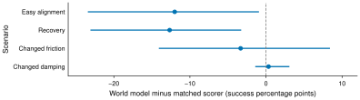

# When Is a World Model Worth Consulting?

**Task, Capacity, and Horizon in Simulated Control**

Aravind Kanappan and Vasanth Pugalenthi

[Reproduction guide](docs/reproduction.md) · [Experiment protocols](docs/) · [Reference results](results/) · [MIT license](LICENSE)

Code and reference data for comparing a direct policy, future-state prediction, and direct candidate scoring in simulated navigation and Push-T manipulation. The experiments examine task conditions, predictor capacity, lookahead horizon, and inference cost. The experiment protocols document the scope of each comparison.



*World-model minus matched-scorer success, with pointwise paired 95% crossed-bootstrap intervals. Three auxiliary seeds and 100 shared test resets per condition. Negative values favor direct scoring.*

## Start here

Use Python **3.11** and [uv](https://docs.astral.sh/uv/getting-started/installation/). Run commands from the repository root. The CPU recipes target Linux; use WSL2 for the CPU pilot on Windows. The GPU recipe supports Linux and Windows with an NVIDIA CUDA-compatible GPU.

```bash
git clone https://github.com/VasPug/robot-world-model-study-.git
cd robot-world-model-study-
uv sync --locked

# No model downloads or training: check the published reference data.
uv run --locked python scripts/verify_results.py

# Recompute the extended manipulation statistics on CPU.
uv run --locked python scripts/analyze_gpu.py --check-reference
```

Reference files stay in `results/`. Recomputed analyses and new runs go into `outputs/`; downloaded inputs go into `.cache/pusht/`. Both are ignored by Git. The CPU and CUDA environments have separate committed lockfiles.

## Run the experiments

| Experiment | Hardware | Command | Protocol |
| --- | --- | --- | --- |
| Navigation, all methods and adaptation budgets | CPU | `bash run_navigation.sh` | [Navigation](docs/navigation-protocol.md) |
| Push-T pilot: train auxiliaries and evaluate policy | CPU | `bash run.sh --config configs/pusht/baseline.json` | [Pilot](docs/pusht-protocol.md) |
| Push-T pilot: evaluate direct multi-step predictor | CPU | `bash run.sh --config configs/pusht/world_model_b.json` | [Pilot](docs/pusht-protocol.md) |
| Manipulation capacity × horizon × physics study | NVIDIA GPU | `bash run_gpu.sh` | [Extended manipulation](docs/gpu-horizon-protocol.md) |

These commands run the **full recorded configurations**. The [reproduction guide](docs/reproduction.md) covers all pilot variants, released versus retrained weights, Windows commands, compute requirements, analysis, and figure regeneration. `--dry-run` prints the effective configuration without downloading or executing a study:

```bash
bash run_navigation.sh --dry-run
bash run.sh --config configs/pusht/direct_scorer.json --dry-run
uv run --locked python -m gpu_extension.study --dry-run
```

The full GPU study requires CUDA even though its results can be reanalyzed on CPU. Dataset and policy downloads are verified against [pinned SHA-256 hashes](assets.json). The small pilot auxiliary checkpoints are included; the full-study GPU checkpoints are recreated by training.

## Reproduce analyses and figures

```bash
uv run --locked python scripts/analyze_navigation.py
uv run --locked python scripts/analyze_pusht.py
uv run --locked python scripts/analyze_gpu.py --check-reference

# Figures use CPU only. The committed PDFs/SVGs are ready to use.
uv run --locked python figs/make_gpu_paper_figure.py
```

Figure font selection follows installed fonts; the committed figures use Arial. If Arial is absent, the renderer selects an available sans-serif font, so regenerated file bytes may differ. Outcomes and intervals come from the bundled data.

## Validation

```bash
uv run --locked python -m unittest discover -s tests -v
uv run --locked python -m unittest gpu_extension.test_study -v
```

The second command skips four CUDA-dependent tests on a CPU host. To exercise CUDA paths, run it with `uv run --project gpu_extension --locked` on a CUDA host. The policy-checkpoint test also requires the downloaded `transformer.ckpt`; set `PUSHT_CACHE_DIR` if you use a nondefault cache. Inspect test skips when assessing GPU coverage. GitHub Actions checks the reference snapshot, CPU tests, and statistical reanalysis.

## Repository map

- `navigation.py`: grid navigation, adaptation, and strategy selection.
- `experiment.py`, `configs/pusht/`: CPU manipulation pilot and four method configurations.
- `gpu_extension/`: batched manipulation study and CUDA dependency lock.
- `scripts/`: reference-data verification and statistical reanalysis.
- `results/`: compact reference episodes, summaries, and pilot checkpoints.
- `figs/`: study figures, plotting code, and figure data.
- `vendor/`: minimal, revision-pinned Diffusion Policy implementation with its original MIT license.

## Citation and license

Please cite this repository when using its code or reference data. [CITATION.cff](CITATION.cff) provides author and title metadata. This repository's original code is MIT licensed. Third-party code and external model/data assets retain their respective notices and terms. See [THIRD_PARTY_NOTICES.md](THIRD_PARTY_NOTICES.md).
